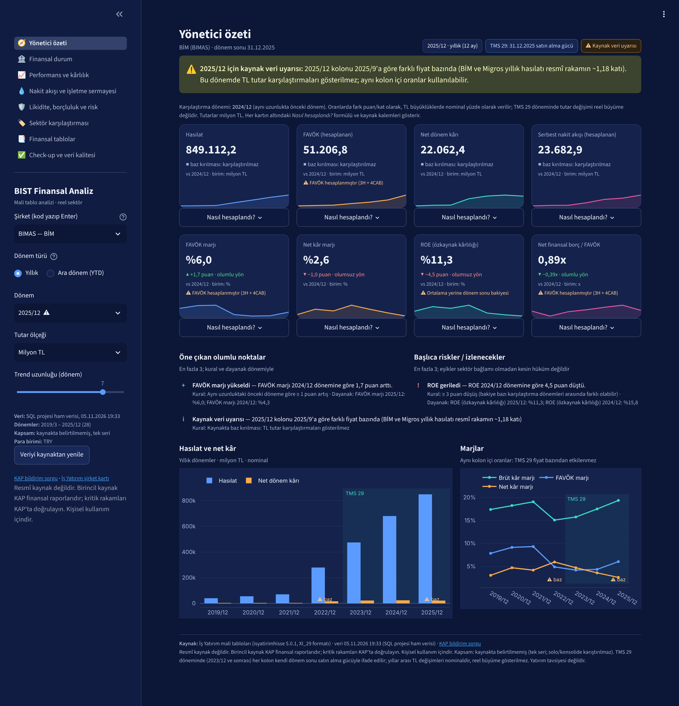
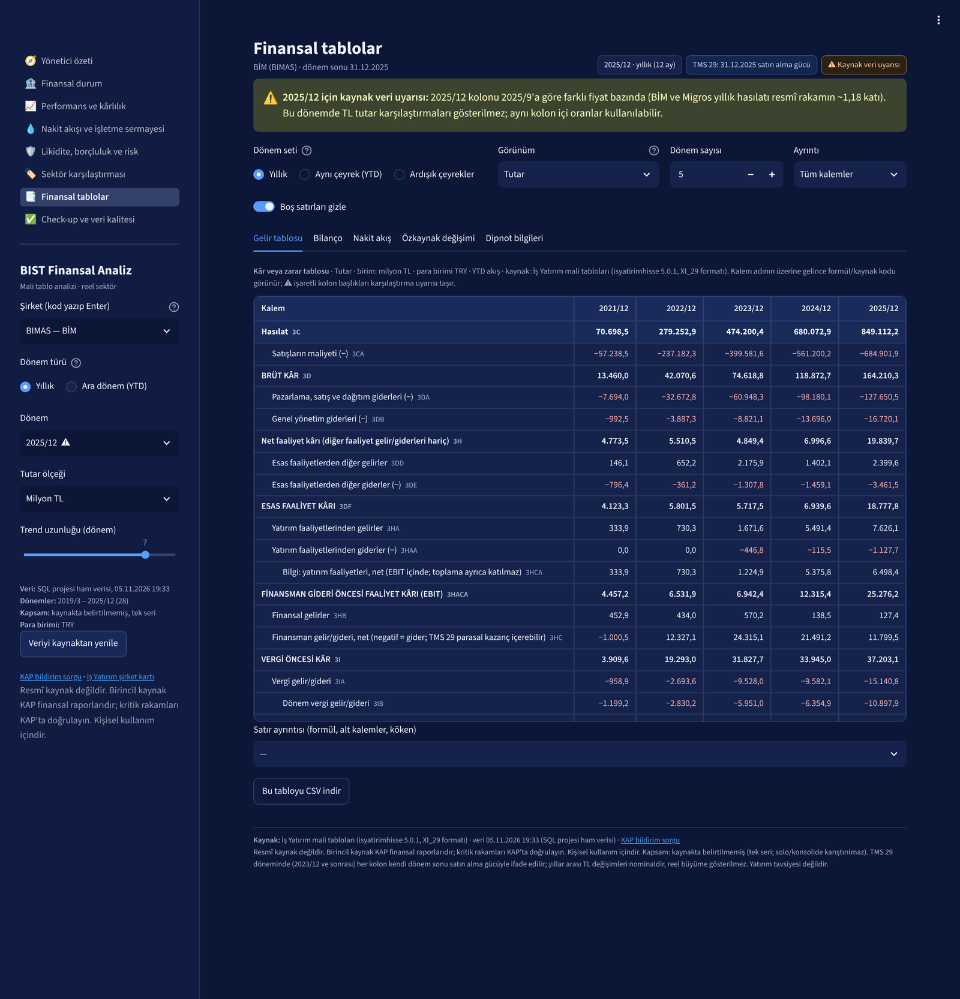
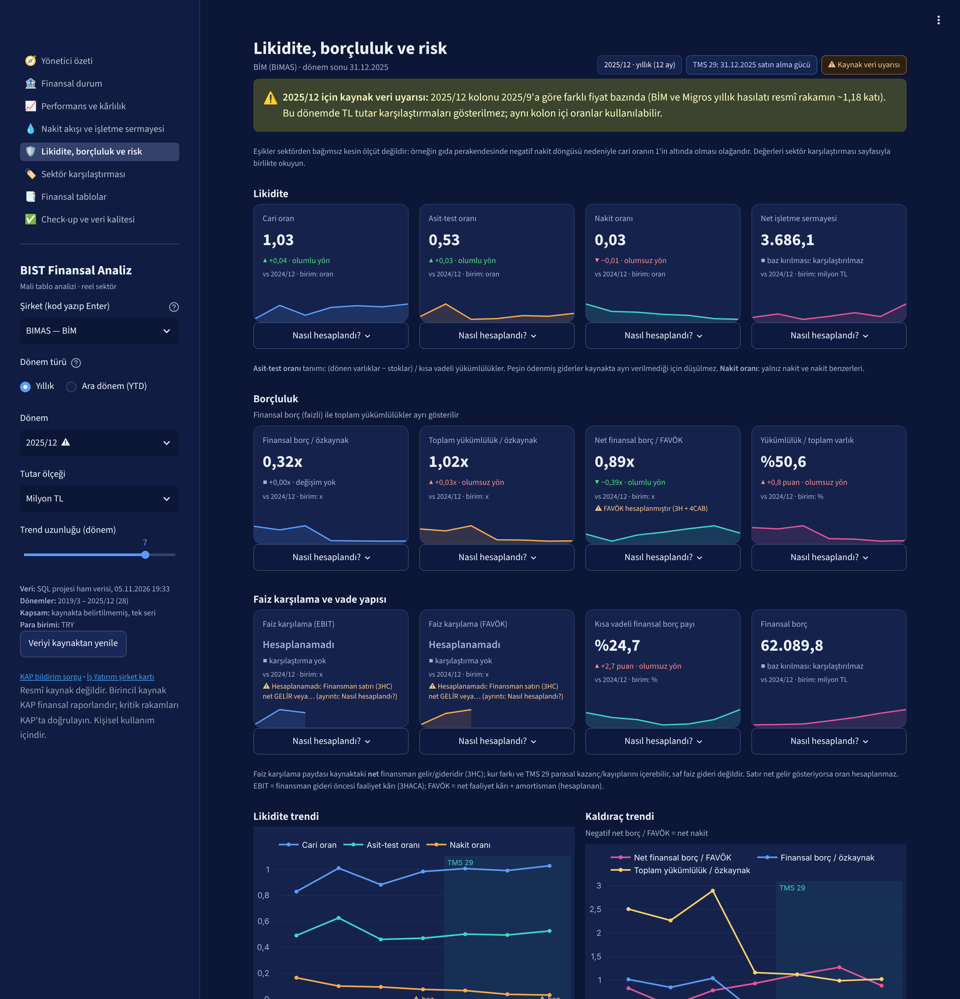
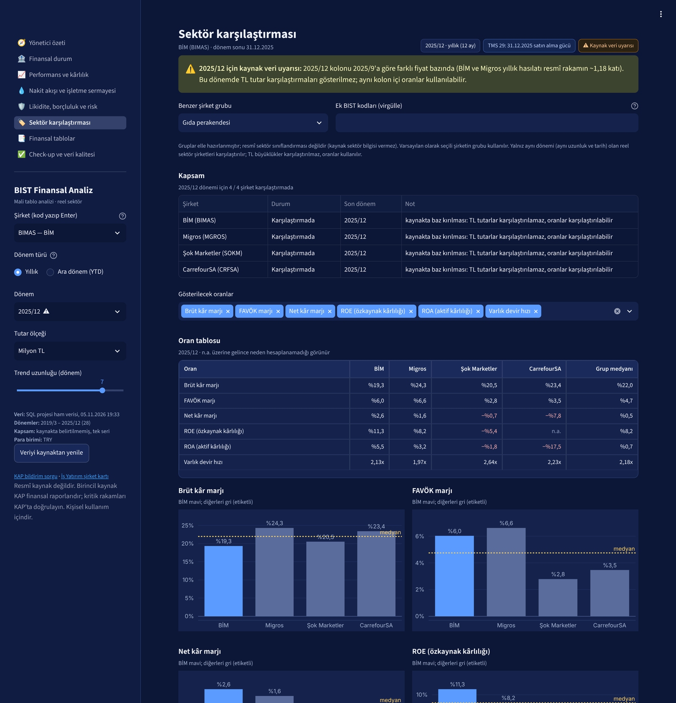

# BIST Finansal Analiz: financial statement analysis app for Borsa Istanbul companies

Type a BIST ticker and get a full financial-statement analysis: the statements themselves, horizontal and vertical analysis, profitability and DuPont, cash flow and working capital, liquidity and leverage, peer comparison and a rule-based check-up report. Every number shows where it comes from, and every ratio shows how it was calculated. Built with Python and Streamlit; the interface is in Turkish.

This is the follow-up to [bist-retail-finance](https://github.com/emre-cakir0/bist-retail-finance), a SQL Server and Power BI pipeline for four BIST retailers. The analysis rules developed there were moved into a Python package (`bistfa`) that works for any non-financial BIST company, and the app's results are tested against that pipeline (3,136 values, 0 differences).



| Statements with formula hovers and drill-down | Liquidity, leverage and risk | Peer comparison |
|---|---|---|
|  |  |  |

## What it does

| Page | Content |
|---|---|
| Yönetici özeti (executive summary) | Eight KPI cards, each with period, unit, comparison period and method, warnings, trend and a "how was this calculated?" panel; top positives and risks with their rules and evidence |
| Finansal durum (financial position) | Asset and funding structure (vertical analysis), horizontal analysis table, net working capital |
| Performans ve kârlılık (performance) | Income-statement and margin trends, ROE/ROA, DuPont table with a log decomposition of what drove the change in ROE |
| Nakit akışı ve işletme sermayesi (cash flow) | Operating cash flow, capex, free cash flow, cash conversion, inventory/receivable/payable days and cash conversion cycle, rule-based commentary |
| Likidite, borçluluk ve risk (liquidity and risk) | Current, quick and cash ratios; financial debt shown separately from total liabilities; net debt/EBITDA; interest coverage on EBIT and EBITDA; maturity warning; Altman Z'' with eligibility checks and caveats |
| Sektör karşılaştırması (peers) | Same-group peers by default, coverage table (included / excluded and why), same-period ratios only, group median |
| Finansal tablolar (statements) | Income statement, balance sheet, cash flow, a reconstructed statement of changes in equity, notes; amount, horizontal (amount and %) and vertical views; formula and source code on hover; row drill-down to sub-items and provenance; CSV export |
| Check-up ve veri kalitesi (check-up) | Summary, strengths, items to watch, uncomputable metrics with reasons, data warnings, data-quality test results; Excel, HTML (print to PDF) and CSV downloads |

## How the analysis stays honest

**Provenance on every value.** The internal model is a long fact table. Each value carries company, source item code and name, standard key, statement, period start and end (or balance-sheet date), YTD flow vs point-in-time balance, scope, currency and scale, source and fetch time, reporting framework, price basis, and reported vs derived. Information the source does not provide (consolidated vs solo scope, filing date, sector) is stated as missing, not guessed.

**One metric registry.** 43 metrics are defined once in `bistfa/metrics.py`. Each result returns its value, unit, formula, the exact input items used, the balance basis, whether it was annualised and, if it could not be computed, why. There are no silent zeros: a blank value always has a reason in the interface.

**Comparability rules for Turkish inflation accounting (TMS 29).**
- From 2023/12 each column is in its own period-end purchasing power. Ratios are computed inside a single column. TL changes across periods are labelled *nominal*, and real growth is not shown.
- Periods with a known or auto-detected price-basis break in the source never show TL changes.
- Comparisons always use a period of the same length (9M vs 9M); interim flows are annualised only where stated.
- Average balances are used only when both balances are on the same price basis; otherwise period-end balances are used, and the result says so.
- No percentage change is shown on a zero, negative or sign-changing base.

**Explicit definitions.**
- EBITDA is not reported in the source. It is calculated (net operating profit + D&A), labelled as calculated, and not used when it is below 1% of revenue.
- Net debt uses explicit financial debt only.
- ROE uses parent-company profit over parent-company equity.

**Two findings about the source data.**
- Line `3HC`, labelled "finance expenses", is a signed *net* finance income/expense: pre-tax profit = EBIT + financial income + `3HC` holds exactly in every period checked. It turns positive under TMS 29 monetary gains, so pure interest expense cannot be isolated. Interest coverage is computed only when the line is a net expense. This also corrected a sign assumption in the earlier SQL pipeline.
- Line `3HCA` repeats investment items that are already inside EBIT, so it is shown as an information line and kept out of totals.

**Rule-based findings, no health score.** Findings show the rule and the evidence (metric, period, value). Thresholds are starting points and are adjusted for context: a current ratio below 1 is reported as information, not a risk, when the cash conversion cycle is negative, as in food retail. A single weighted health score is deliberately not produced, because it cannot be explained without sector-specific thresholds. Altman Z'' (emerging-market variant) is shown only for annual periods of non-financial companies, with its components and caveats, and never as a bankruptcy probability.

The full audit of decisions, rules and test results is in [docs/APP_AUDIT.md](docs/APP_AUDIT.md) (Turkish).

## Validation

| Test | Command | Result |
|---|---|---|
| Unit tests | `python tests/test_core.py` | 9 / 9: safe % change, comparability codes, statement identities, DuPont = ROE, average-balance rule, reasons for uncomputable metrics, blocked TL change on basis breaks, statements and equity reconciliation, Altman eligibility |
| Parity with the SQL pipeline | `python tests/test_parity.py` | 28 metrics × 4 companies × 28 periods: 3,136 values, 0 differences; 5 deliberate definition differences reconstructed from source items and verified separately (needs the `bist-retail-finance` database) |
| UI smoke test | `python tests/test_app_pages.py` | 8 pages × 5 scenarios (annual, interim, negative equity, basis break, pre-TMS 29) run headless with 0 errors |
| Source identities | in app | 20 total-equals-components identities checked every period (e.g. BİM: 579 pass, 3 explained). Inconsistencies in the source are shown as failures, not hidden |
| Non-retail company | ULKER | 540 checks, 0 failures; the 2022/12 and 2025 price-basis breaks were detected automatically. Bank tickers are rejected with a clear message |

## Run it

Requirements: Python 3.11+ and an internet connection for the first fetch of each company.

```powershell
pip install -r requirements.txt
streamlit run app/app.py        # or double-click app/run_app.bat; opens http://localhost:8501
python tests/test_core.py       # fetches the four retailers on first run
```

Fetched statements are cached in `app/.cache/` and are not committed. The app listens on `localhost` only.

## Repository layout

| Path | Purpose |
|---|---|
| `bistfa/source.py` | Fetching (isyatirimhisse) with per-year retries, cache, ticker validation |
| `bistfa/model.py`, `catalog.py`, `periods.py` | Fact table with provenance, statement layouts and derived rows, period and comparability logic |
| `bistfa/quality.py` | Identity checks, quarter plausibility, automatic basis-break detection |
| `bistfa/metrics.py`, `company.py` | Metric registry and company view (comparison method per metric) |
| `bistfa/statements.py`, `findings.py`, `risk.py`, `peers.py`, `report.py` | Statement tables, rule-based findings, Altman Z'', peer groups, Excel/HTML export |
| `app/` | Streamlit interface (8 pages); no calculations |
| `tests/` | Unit, parity and UI smoke tests |
| `docs/` | Audit and decision record, screenshots |

## Limitations

- **The source is unofficial.** Data comes from İş Yatırım via the `isyatirimhisse` library. KAP is the primary source, and critical figures should be checked there.
- **Real growth is not shown.** It needs a CPI series to restate periods to a common price basis.
- **Annualisation ignores seasonality.** Interim flows are scaled to a full year without adjusting for seasonal patterns.
- **Financial debt may include leases.** The source does not separate lease liabilities.
- **Peer groups are hand-made.** They are not an official sector classification.
- **Not investment advice.**
